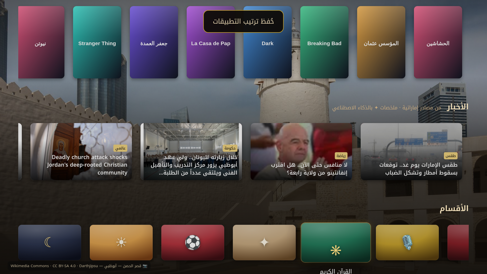
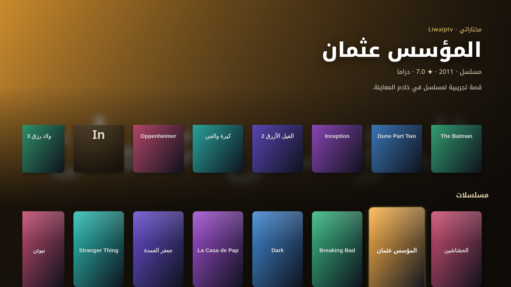

# الكود TV — Alcode TV

> الاسم السابق: «مجلس» (Majlis TV). اسم الحزمة بقي `ae.majlis.tv` حتى تتحدث النسخ المثبتة تلقائياً.

واجهة (Launcher) عربية لأجهزة Android TV بهوية إماراتية: الساعة مع التاريخين الهجري والميلادي، ومواقيت الصلاة لكل إمارة مع تنبيه الأذان، والقرآن الكريم، ودوري المحترفين الإماراتي، والطقس، ومساعد ذكي بالعربية.




## التثبيت على التلفزيون
1. من الإعدادات فعّل «مصادر غير معروفة» لتطبيق Downloader أو لمدير الملفات.
2. نزّل ملف APK من صفحة [Releases](../../releases/latest) وثبّته. يمكنك أيضاً استخدام الأمر `adb install alcode-tv-1.1.0.apk`.
3. اضغط زر Home واختر «الكود TV» واجهةً افتراضية. في Google TV قد تحتاج إلى adb لتغيير الواجهة الافتراضية.
4. شاشة التوقف: الإعدادات ← شاشة التوقف ← «الكود TV».
5. يتحقق التطبيق من التحديثات بنفسه من GitHub Releases عبر صفحة الإعدادات.

## الميزات
- **مواقيت الصلاة:** تُحسب على الجهاز بطريقة الإمارات (الفجر والعشاء 18.2°). أبوظبي هي الافتراضية، ويمكن اختيار الإمارات الثماني الأخرى. قورنت النتائج بـ Aladhan (method 16).
- **التاريخ الهجري:** تقويم أم القرى.
- **القرآن الكريم:** نص Tanzil العثماني مع التفسير الميسر والجلالين.
- **الدوري:** من TheSportsDB، والطبقة المجانية محدودة. يُخفى القسم إذا لم تتوفر بيانات.
- **الطقس:** من Open-Meteo.
- **الذكاء الاصطناعي:** مساعد يقبل الصوت عند توفره، وموجز يومي، واقتراحات تطبيقات حسب وقت الاستخدام، وشرح للآيات مع ذكر المصادر.
- **التنقل:** مصمم لريموت التلفزيون (D-pad).

## الجديد في 1.1.0
- **أيقونات بأسلوب Apple TV:** بطاقات 16:9 بزوايا مستديرة، تكبير ×1.1 مع ظل وميلان (parallax) ولمعة متحركة، والاسم يظهر تحت البطاقة عند التحديد فقط. يُستخدم شعار التطبيق (banner) إن وُجد، وإلا الأيقونة على تدرّج من لونها الغالب (AndroidX Palette).
- **التطبيقات الجديدة تظهر فوراً** (مستقبِل PACKAGE_ADDED/REMOVED/CHANGED)، وتُضاف في آخر الصف. لإعادة الترتيب: اضغط مطولاً على «موافق» ثم ◀ ▶ ثم «موافق». يُحفظ الترتيب.
- **طبقة ذكاء اصطناعي شاملة:** زر الميكروفون/البحث في الريموت أو زر القائمة يفتح شريط أوامر عربياً. يحوّل Gemini الطلب إلى استدعاء أداة: فتح تطبيق، أو تشغيل قناة أو فيلم من Liwaiptv، أو فتح قسم، أو عرض أخبار تصنيف معين، أو فتح سورة أو آية، أو تغيير إعداد، أو تذكير، أو الموجز، أو «ما هذا؟» لشرح ما على الشاشة، أو الترجمة. بلا اتصال يعمل محلّل أوامر محلي.
- **واجهة رئيسية مخصّصة:** ترتيب الصفوف حسب الوقت ومواقيت الصلاة والاستخدام، مع تحية يومية وموجز مقروء صوتياً.
- **الأخبار:** من الإمارات اليوم وسكاي نيوز عربية وThe National، مع شريط عاجل. التصنيف والملخصات بالذكاء الاصطناعي وعليها وسم ✦، ويُذكر المصدر والوقت والرابط دائماً.
- **Liwaiptv:** بيانات اشتراك Xtream تُدخل مرة واحدة وتُحفظ مشفّرة (Android Keystore AES-GCM). فيها صفوف القنوات والأفلام والمسلسلات ومتابعة المشاهدة، وقسم «مختاراتي» بخلفية تتغير مع العنصر المحدد. التشغيل يتم في Liwaiptv إن كان مثبتاً.
- **رمضان:** إمساكية وعدّاد للإفطار محسوبان على الجهاز. **تنبيهات الطقس** مبنية على حدود من Open-Meteo. **وضع الأطفال** بمدة محددة.

## الجديد في 1.2.0 — «غسق ليوا»
- أيقونات التطبيقات الحقيقية: بانر التلفزيون من التطبيق نفسه، وإلا الأيقونة التكيفية بحجم كامل، وإلا الأيقونة العادية، مع الاسم الحقيقي للتطبيق.
- شريط تبويبات علوي بأسلوب tvOS مع زر الإعدادات، و«Top Shelf» بصورة سينمائية كاملة، وصف من 5 مفضّلات فوق شبكة التطبيقات.
- هوية بصرية جديدة موثّقة في DESIGN.md: خطّا الكوفي والنسخ، وخط السدو للتركيز، وحبيبات فيلمية خفيفة.
- ✦ ماذا أشاهد الآن: اقتراحات مع سبب قصير، وبحث بلغة طبيعية، وتصنيف ذكي للقنوات مع دمج نسخ HD/SD، وصور وملخصات من ويكيبيديا عند التطابق المؤكد فقط.
- اقتراحات استباقية: إيقاف مؤقت قبل الأذان، ووضع الأطفال وقت النوم، وتذكير ببداية المباريات.

## البناء
```
export TV_AI_API_KEY=...   # أو tv.ai.key في local.properties
./gradlew assembleRelease
```
يُحقن المفتاح وقت البناء في BuildConfig ولا يُحفظ في المستودع. يمكن أيضاً إدخال مفتاح بديل من إعدادات التطبيق. يدعم التطبيق Gemini وOpenAI-compatible وAnthropic.

الصور والخطوط والبيانات مذكورة في [CREDITS.md](CREDITS.md). الكود مرخص بـ MIT.
