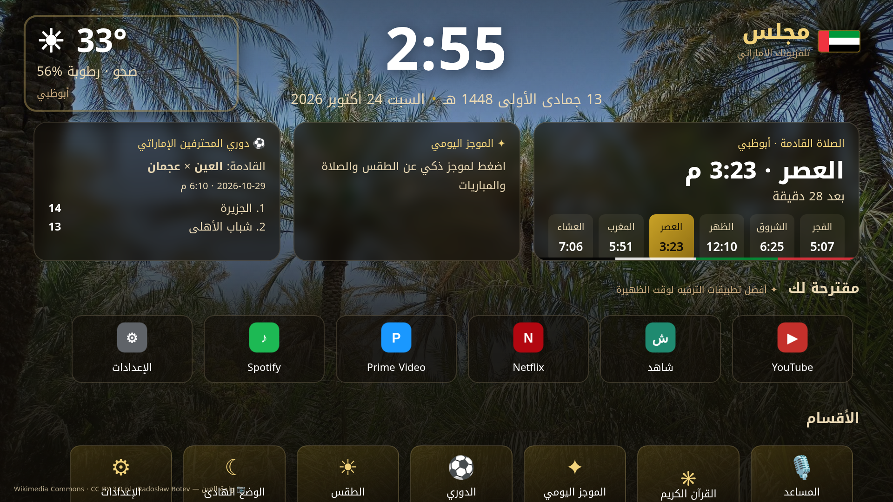

# مجلس — Majlis TV

واجهة (Launcher) عربية لأجهزة Android TV بهوية إماراتية: الساعة مع التاريخين الهجري والميلادي، ومواقيت الصلاة لكل إمارة مع تنبيه الأذان، والقرآن الكريم، ودوري المحترفين الإماراتي، والطقس، ومساعد ذكي بالعربية.



## التثبيت على التلفزيون
1. من الإعدادات فعّل «مصادر غير معروفة» لتطبيق Downloader أو لمدير الملفات.
2. نزّل ملف APK من صفحة [Releases](../../releases/latest) وثبّته. يمكنك أيضاً استخدام الأمر `adb install majlis-tv-1.0.0.apk`.
3. اضغط زر Home واختر «مجلس» واجهةً افتراضية. في Google TV قد تحتاج إلى adb لتغيير الواجهة الافتراضية.
4. شاشة التوقف: الإعدادات ← شاشة التوقف ← «مجلس».
5. يتحقق التطبيق من التحديثات بنفسه من GitHub Releases عبر صفحة الإعدادات.

## الميزات
- **مواقيت الصلاة:** تُحسب على الجهاز بطريقة الإمارات (الفجر والعشاء 18.2°). أبوظبي هي الافتراضية، ويمكن اختيار الإمارات الثماني الأخرى. قورنت النتائج بـ Aladhan (method 16).
- **التاريخ الهجري:** تقويم أم القرى.
- **القرآن الكريم:** نص Tanzil العثماني مع التفسير الميسر والجلالين.
- **الدوري:** من TheSportsDB، والطبقة المجانية محدودة. يُخفى القسم إذا لم تتوفر بيانات.
- **الطقس:** من Open-Meteo.
- **الذكاء الاصطناعي:** مساعد يقبل الصوت عند توفره، وموجز يومي، واقتراحات تطبيقات حسب وقت الاستخدام، وشرح للآيات مع ذكر المصادر.
- **التنقل:** مصمم لريموت التلفزيون (D-pad).

## البناء
```
export TV_AI_API_KEY=...   # أو tv.ai.key في local.properties
./gradlew assembleRelease
```
يُحقن المفتاح وقت البناء في BuildConfig ولا يُحفظ في المستودع. يمكن أيضاً إدخال مفتاح بديل من إعدادات التطبيق. يدعم التطبيق Gemini وOpenAI-compatible وAnthropic.

الصور والخطوط والبيانات مذكورة في [CREDITS.md](CREDITS.md). الكود مرخص بـ MIT.
